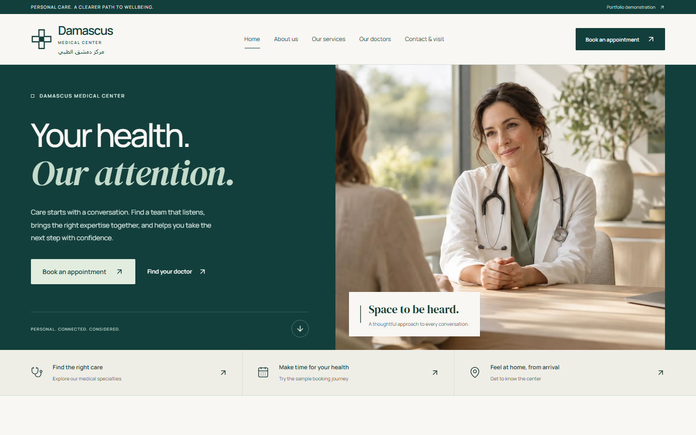
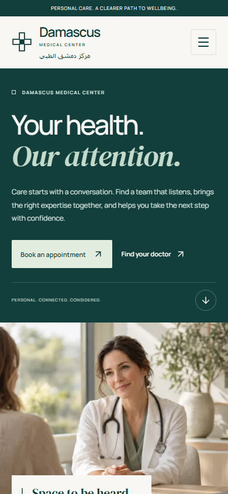
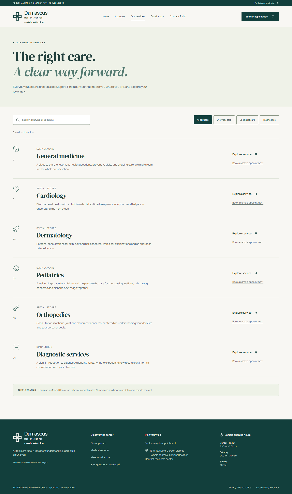
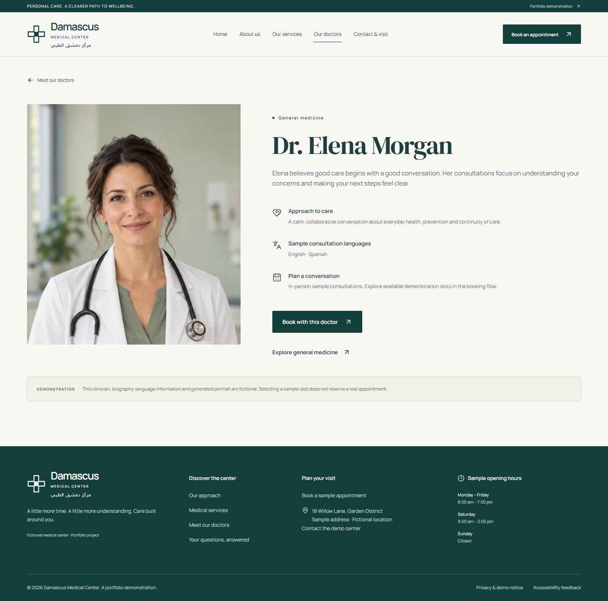
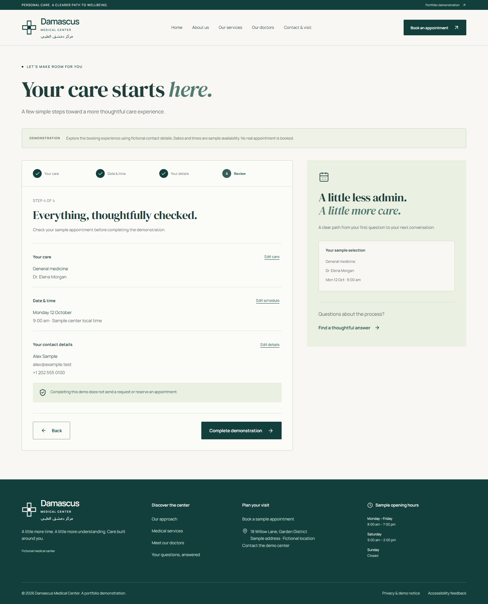
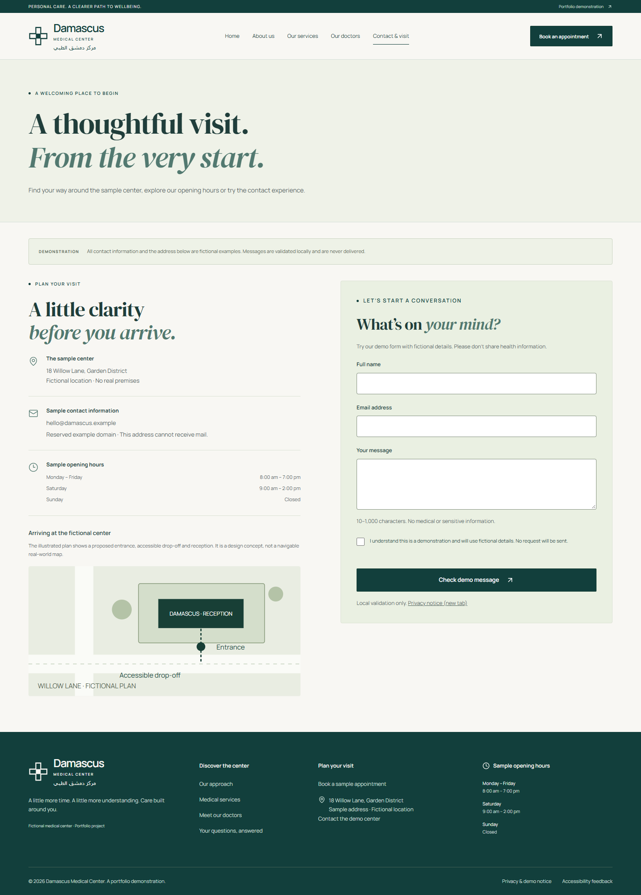

# Damascus Medical Center

A medical center website with searchable care directories and a validated appointment demonstration.

Built with **React, TypeScript and Tailwind CSS**, this project lets visitors explore six specialties, find a clinician and work through a four-step appointment journey. It brings together typed domain data, client-side routing, controlled forms and a shared visual and motion system.

**[Live website](https://damascus-medical-center.netlify.app/)** · [Source code](https://github.com/SaadSinan-dev/Medical-Center-Website) · [Run locally](#local-development) · [Verification](#testing-and-verification)



> Damascus Medical Center is a fictional portfolio brand. Clinicians, premises and availability are sample content; forms demonstrate client-side interactions without sending appointments or messages.

## What visitors can do

| Experience              | Implemented behavior                                                                                                                                                     |
| ----------------------- | ------------------------------------------------------------------------------------------------------------------------------------------------------------------------ |
| Discover care           | Search service names and descriptions, combine the search with category filters, open detail pages and recover from empty results.                                       |
| Find a clinician        | Search the three sample profiles by name, filter by specialty and carry a doctor selection into the appointment flow.                                                    |
| Try an appointment      | Choose care, select a sample date and time, enter fictional contact details and review an editable summary. Each step validates before continuing.                       |
| Plan a visit            | Explore sample hours and an illustrative site plan, use the locally validated contact form and read the about, FAQ and privacy pages.                                    |
| Navigate across devices | Use the shared header, mobile menu, keyboard-operable disclosures and responsive layouts. Unknown routes and unknown service/doctor IDs have a dedicated not-found view. |

## More application screenshots

These are captures of the rendered application. The photographs within the interface are generated assets, with provenance recorded in [ASSETS.md](docs/ASSETS.md).

<details>
<summary>View mobile, service discovery, a clinician profile, booking review and contact</summary>

### Mobile homepage

The same content hierarchy adapts to a single-column layout, with the main actions before photography.



### Service directory



### Clinician profile



### Appointment review



### Contact and visit planning



</details>

## Design and UX decisions

**Make the next action easy to find.** The hero offers appointment and clinician routes; the task strip also points to services and visit information. Service and clinician details carry relevant selections into booking, so visitors do not have to choose the same specialty again.

**Give the identity a consistent place.** The geometric medical mark, deep teal, warm ivory and sage recur across navigation, content and forms. The wordmark includes **مركز دمشق الطبي**, with its own language and right-to-left direction. The rest of the website is English; this is bilingual branding rather than full Arabic localization.

**Change the composition to fit the content.** The desktop hero uses a 48/52 text-and-image split within a 1600px content cap. An asymmetric specialty index, architectural care section and portrait-led team section create different reading rhythms. On small screens, text and actions precede images, sections stack and navigation becomes a disclosure menu.

**Use motion to direct attention and explain changes.** Hero copy enters in sequence alongside a photographic mask reveal. Selected section groups animate once on entry. Short transitions provide feedback on buttons, links, mobile navigation, FAQ disclosures and booking steps. There are no looping effects or continuous scroll handlers.

See the [design and motion specification](docs/DESIGN.md) for tokens, compositions and timing details.

## Technology stack

| Area                  | Technologies and role                                                                                                                                                                        |
| --------------------- | -------------------------------------------------------------------------------------------------------------------------------------------------------------------------------------------- |
| Interface and routing | React 19, strict TypeScript and React Router 7: component composition, typed contracts and client-side routes.                                                                               |
| Styling and build     | Tailwind CSS 4, shared CSS recipes and Vite 8: theme tokens, page layouts, development server and production bundles. The Vite configuration also enables React Compiler.                    |
| Validation            | Zod 4: appointment and contact schemas. Controlled React inputs and component state manage the forms; there is no separate form-state library.                                               |
| Motion and assets     | CSS animations, IntersectionObserver and the Web Animations API; Lucide icons; locally served Manrope and DM Serif Display fonts; optimized WebP photography. No motion library is required. |
| Quality tools         | Vitest and React Testing Library for helpers and interactions; Playwright and axe-core for browser checks; Oxlint and Prettier for linting and formatting; Sharp for asset preparation.      |

Exact resolved versions are recorded in [package-lock.json](package-lock.json). Scripts and dependency declarations are in [package.json](package.json).

## Architecture

```text
src/
  App.tsx                         shared route layout and lazy secondary pages
  components/                     layout, UI controls, forms, Accordion and Reveal
  data/
    brand.ts                      English and Arabic identity constants
    content.ts                    typed specialties, clinicians, FAQs and hours
  features/
    home/                         hero and homepage section compositions
    appointments/
      Appointments.tsx            draft state, step guards and completion
      steps/                      care, schedule, details and review
  hooks/usePageMeta.ts             route titles and descriptions
  lib/booking.ts                  selection, scheduling and validation helpers
  pages/                          directories, detail routes and supporting pages
  styles/                         identity, homepage and motion rules
  types/domain.ts                 Service, Doctor and AppointmentDraft interfaces
  test/                           component workflow tests and setup
  index.css                       Tailwind theme and shared component recipes
public/images/                    local generated WebP assets
e2e/site.spec.ts                   browser workflows and accessibility checks
scripts/                          screenshot, motion and performance inspection
docs/                             design notes, reports, licenses and screenshots
```

Pages compose shared controls such as `Brand`, `ActionLink`, `PageIntro`, `Field`, `Consent` and `Accordion`. Content stays separate from rendering: a doctor's `serviceId` links the profile to a specialty, while route parameters resolve against the same data used by the directories.

Booking-specific state belongs to its feature rather than a global store. Its step components receive a controlled draft; the parent owns validation and transitions. Pure helpers handle selection normalization and sample date/time rules, which can be tested without rendering the UI.

The shared `Reveal` component checks browser capabilities, observes entry, disconnects after the first reveal and cancels its animation during cleanup. If enhancement APIs are unavailable, content stays visible. It also responds when a visitor changes their reduced-motion preference.

## Appointment workflow and data handling

1. **Care:** select a specialty and an optional matching clinician. A doctor link preselects the corresponding specialty; unknown IDs are ignored. Changing care selections clears dependent schedule choices.
2. **Schedule:** choose from seven generated sample dates after the current date. Sundays are excluded, and Saturday time choices stop before the sample 14:00 closing time. These are local examples, not an availability lookup.
3. **Details:** enter a name, email and phone number, then acknowledge the demonstration. Zod validation supplies inline errors and focuses the first invalid field.
4. **Review:** edit earlier choices without losing contact details, then complete the demonstration. The final view explicitly states that no appointment was booked and provides a reset action.

Only service and doctor IDs travel in the URL. Form details remain in component memory: they are not sent to a server or written to localStorage or sessionStorage. Refreshing or leaving the appointment page clears its draft. The contact form also validates locally and clears entered values on successful validation. Use fictional details when trying either form.

A real booking service would replace local scheduling and completion with authoritative availability and submission endpoints. It would also need server-side validation and defined consent, retention and error handling; those services are outside this frontend.

## Responsive design and accessibility

Layouts use grids, responsive typography and explicit breakpoint rules. Desktop directories and feature sections condense or stack as space narrows; the main navigation switches to a mobile disclosure below 1024px. The browser suite checks principal pages for horizontal overflow at **320, 375, 390, 430, 768, 1024, 1280, 1440 and 1920px**.

Implemented keyboard and accessibility behavior includes semantic landmarks, a skip link, visible focus styles, labeled native controls, grouped radio inputs, error associations and live result counts. Route changes focus the main content; booking transitions focus the stage heading. The mobile menu closes on selection or Escape, with focus returned to its toggle on Escape. FAQs use native `details` and `summary` elements.

Reduced-motion settings disable entrance effects and image transforms. Browser tests also check readable content and working links when IntersectionObserver is unavailable. Axe scans evaluate settled states with reduced motion enabled; separate checks exercise motion behavior. These checks provide evidence about the tested states, not a WCAG certification. Screen-reader user sessions, physical devices and Safari/Firefox testing remain outstanding.

## Local development

Use **Node.js 22.12 or newer** and npm. Verification used Node 24.19.0 and npm 11.17.0. No environment variables, API keys or backend are needed.

```sh
git clone https://github.com/SaadSinan-dev/Medical-Center-Website.git
cd Medical-Center-Website
npm ci
npm run dev -- --host 127.0.0.1 --port 5173
```

Open `http://127.0.0.1:5173` for local development. If the repository is already downloaded, start with `npm ci` in its root.

| Command                                                             | Purpose                                                                             |
| ------------------------------------------------------------------- | ----------------------------------------------------------------------------------- |
| `npm run lint` / `npm run typecheck`                                | Run Oxlint and TypeScript checks.                                                   |
| `npm test` / `npm run test:watch`                                   | Run the unit/component suite once or in watch mode.                                 |
| `npm run test:e2e`                                                  | Run browser workflows and axe checks; Playwright starts or reuses the local server. |
| `npm run build` / `npm run preview -- --host 127.0.0.1 --port 4173` | Type-check and build `dist`, then serve it locally for production inspection.       |
| `npm run format:check` / `npm run format`                           | Check formatting or apply Prettier formatting.                                      |

Browser checks default to an installed Microsoft Edge. To use Playwright's Chromium instead, install that browser and set the channel before running the suite:

```sh
npx playwright install chromium
```

PowerShell:

```powershell
$env:PLAYWRIGHT_CHANNEL = 'chromium'
npm run test:e2e
```

macOS/Linux shells:

```sh
PLAYWRIGHT_CHANNEL=chromium npm run test:e2e
```

## Testing and verification

Verification on **10 October 2026** used the commands above against the actual application.

| Check                                   | Executed result                                                                                                   |
| --------------------------------------- | ----------------------------------------------------------------------------------------------------------------- |
| TypeScript, Oxlint and production build | Passed. The build performs TypeScript checking before bundling.                                                   |
| Vitest / React Testing Library          | 15 tests passed across two files.                                                                                 |
| Playwright                              | 18 browser tests passed, including nine responsive-width cases.                                                   |
| axe-core                                | Zero reported violations across the checked page/state inventory, using WCAG 2 A/AA, 2.1 AA and 2.2 AA rule tags. |
| Documentation                           | Markdown formatting, local links, image references and documented scripts checked against the repository.         |

Unit/component tests cover data relationships, scheduling, schemas, filtering, empty results, route behavior and editable forms. Browser tests cover navigation, direct selection links, invalid choices, booking guards, first-error focus, Enter submission, reset, contact feedback, menu behavior, reduced motion and storage checks.

The public demo was separately checked through direct visits to the homepage, service directory, a clinician profile and a doctor-preselected appointment route. Those visits returned HTTP 200 and rendered the expected headings without page errors; this was a deployment smoke check, not the full local test suite run against production.

Detailed evidence is available in [QA.md](docs/QA.md), [browser results](docs/qa-results.json) and [accessibility results](docs/accessibility-results.json). Existing visual inspection includes desktop at 1440×900 and 1920×1080, mobile, internal pages and intermediate motion frames.

To reproduce visual captures with the local server running on port 5173:

```sh
node scripts/visual-qa.mjs
node scripts/motion-qa.mjs
```

## Performance, metadata and deployment

Secondary routes use `React.lazy`; validation code loads with form-related routes. The hero has responsive image sources and high fetch priority. Below-fold photographs use lazy loading and explicit dimensions. Fonts and images are served locally. The audit's production build emitted approximately **94.72 kB of gzipped initial JavaScript** and **11.54 kB of gzipped CSS**; other routes add their own chunks.

The existing [local performance report](docs/performance-results.json) records three fresh Edge contexts without network or CPU throttling: LCP of 148–200ms, CLS around 0.000073, and no third-party resource requests during the observation window. Those numbers describe a local preview, not the deployed site's field performance or a Lighthouse score. Reproduce observations with the production preview on port 4173 using `node scripts/performance.mjs`.

Routes update document titles, descriptions and Open Graph text through `usePageMeta`. The HTML supplies a favicon, theme color and social image. The fictional demo deliberately uses `noindex, nofollow` and a crawler-disallowing `robots.txt`; it has no sitemap or medical-business structured data. The social image path is relative and should be made absolute if preparing domain-specific sharing metadata.

The [Netlify demo](https://damascus-medical-center.netlify.app/) is publicly available. For another static host, publish `dist` and preserve client-side routing: the repository includes Netlify's `public/_redirects` and a Vercel rewrite configuration. Direct-route refreshes should be checked after deployment.

## Scope and next improvements

The implemented frontend covers discovery, profiles, visit information and local form workflows. Its main extension points are a real booking/contact API with verified organization content, complete Arabic localization, and further assisted-technology and cross-browser evaluation. There is no authentication, content-management service or real-time clinical calendar.

Design rationale is in [DESIGN.md](docs/DESIGN.md), the engineering narrative in [PORTFOLIO_CASE_STUDY.md](docs/PORTFOLIO_CASE_STUDY.md), and generated imagery and font-license details in [ASSETS.md](docs/ASSETS.md).

## Contact

[Portfolio](https://saad-dev-portfolio.netlify.app) · [GitHub](https://github.com/SaadSinan-dev) · [LinkedIn](https://www.linkedin.com/in/saad-sinan-a34557374/) · [WhatsApp](https://wa.me/963980562304)
